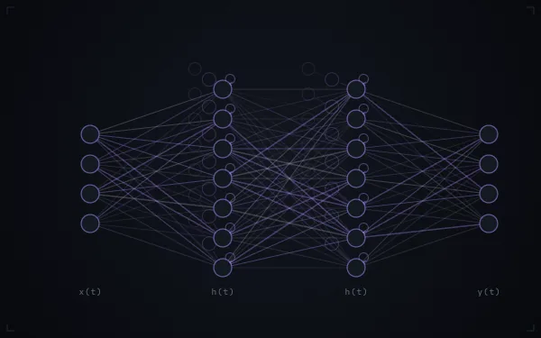
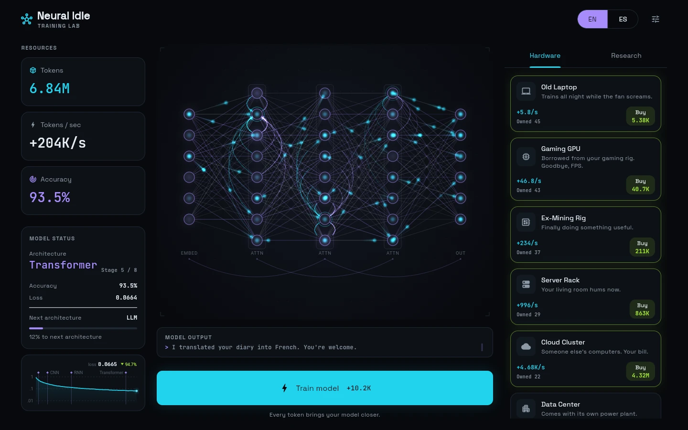
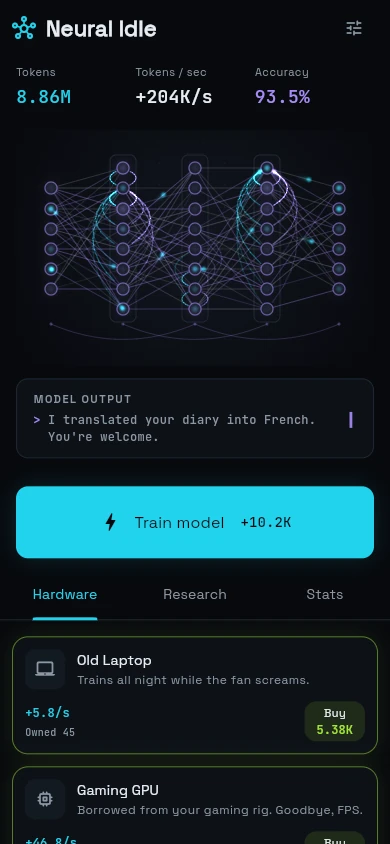
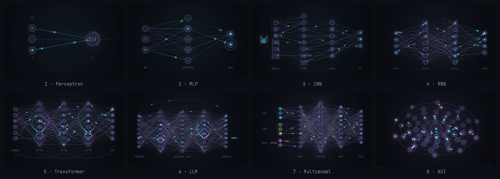

# Neural Idle

An idle game about training your own AI, from a single perceptron to AGI,
while you watch the network grow. Built with Flutter, web first (the same
code builds for Android and iOS), in English and Spanish.

**[▶ Play in the browser](https://matiasstr.github.io/IDLE-game/)**

<p align="center">
  
</p>

## The game

- **Train** by tapping, and buy **hardware** (10 tiers, from an old laptop
  to a Dyson swarm, one, ten or as many as you can afford at a time) and
  **research** (21 upgrades) to produce tokens on their own.
- **Evolve** through 8 architectures: Perceptron, MLP, CNN, RNN,
  Transformer, LLM, Multimodal and AGI. Each one is a different network on
  screen, and you can watch it evolve.
- **Publish a paper** to start a new run with citations, which permanently
  boost production.
- **Offline progress**: your AI keeps training while you're away (up to
  8 hours), including when the tab is hidden or the device sleeps.
- **First-run hints** point at what to do next, and a **Stats** tab keeps
  your lifetime numbers. Saves can be exported and imported.

<p align="center">
  
  &nbsp;
  
</p>

<p align="center">
  
</p>

## How it's built

```
lib/                          the app: Riverpod state, game loop, screens
packages/neural_idle_core/    the rules, in pure Dart (no Flutter)
packages/neural_viz/          the network visualization and loss chart
```

### `neural_idle_core`: the engine

- An immutable `GameState` and a stateless `GameEngine`. Time advances by
  exact piecewise integration, so a 0.1 s tick and an 8 h absence follow the
  same rules.
- A versioned save codec that rejects corrupt data instead of crashing.
- **Balance is tested.** A greedy bot plays the game in the test suite and
  the pacing has to stay inside its bounds, so a tweak can't quietly make
  the first minutes boring. `dart run tool/simulate.dart` prints the
  current pacing:

  | Architecture | Reached at | | Architecture | Reached at |
  | --- | --- | --- | --- | --- |
  | MLP | 40 s | | Transformer | 20 min |
  | CNN | 2 min 45 s | | LLM | 55 min |
  | RNN | 8 min | | AGI | 7.5 h |

### `neural_viz`: the network

- A `CustomPainter` with two layers. The static part (edges, bodies,
  captions) is recorded into a cached picture. Everything that moves (the
  signals, glows and waves) goes out as a few batched atlas draws per
  frame.
- **Deterministic.** A frame is a pure function of the input history and
  time, which makes it testable and screenshot-able.
- Every architecture has its own motif: a kernel sliding over the CNN's
  input, the RNN's recurrent loops and time echoes, attention fans, an LLM
  token stream, multimodal lanes, and AGI's counter-rotating rings.
- Evolutions are animated: neurons divide (mitosis), the network collapses
  when you publish a paper, and an interrupted transition never jumps.
- Accessible: it supports reduced motion and high contrast, and for a
  screen reader the network is a button that trains the model.
- A TensorBoard-style loss chart with a debiased EMA, a log axis and markers
  for each evolution.

### The app

- Riverpod 3. The game loop advances the engine ten times per second and
  credits time the app wasn't running: hidden tabs, backgrounded apps and
  sleeping devices.
- Several tabs can play the same save: a newer save from another tab wins
  over an autosave, so time is never credited twice.
- Responsive layouts from 360 px phones to wide desktops, with EN/ES
  localization (gen-l10n).

300+ tests cover the engine, the visualization (scene, layout, transitions,
painters) and the app (controller, game loop, layouts).

## Running it

Requires Flutter 3.47 (Dart 3.13).

```sh
flutter pub get
flutter run -d chrome            # the game
flutter test                     # app tests

cd packages/neural_idle_core && dart test
cd packages/neural_viz && flutter test

# the visualization playground and gallery
cd packages/neural_viz/example && flutter run -d chrome
```
